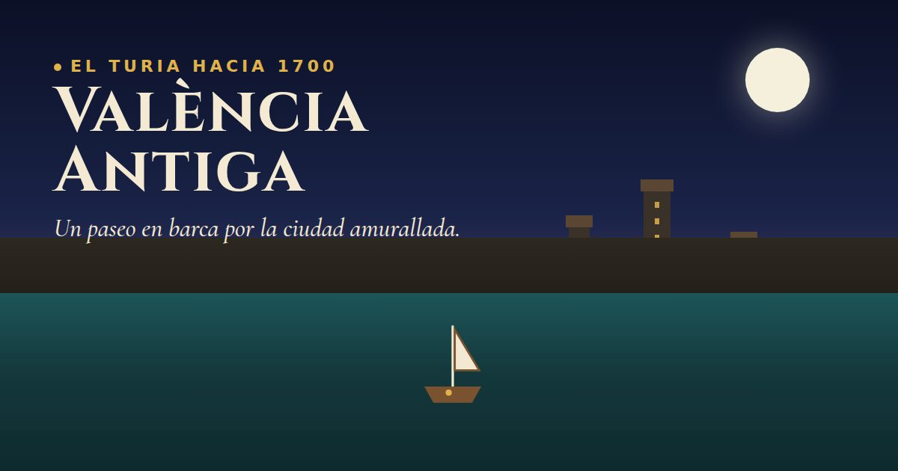

# València Antiga

[](https://valencia-antiga.pages.dev/)

Paseo en barca, en el navegador, por el viejo cauce del Turia y la València amurallada de hacia 1700.

**[Entrar al paseo](https://valencia-antiga.pages.dev/)** · castellano, valenciano e inglés · no hay nada que instalar

El río hacía entonces de foso. Desde el agua se ven la muralla y sus puertas, los cinco puentes de piedra y el perfil de torres y campanarios. Hay dieciocho puntos de interés que descubrir, cada uno con su ficha, y uno más: al entrar en su aro se hace de noche. Es «quedarse a la luna de València».

Es una reconstrucción aproximada. Los sitios están donde estaban; las formas son un esbozo. Qué es fiable y qué no está en [docs/sources.md](docs/sources.md).

## Qué se puede hacer

| | |
| --- | --- |
| **Navegar** | 2,8 km de río, desde la altura de las Torres de Quart hasta pasado el de la Mar. La barca frena contra las orillas y, al llegar a un puente, se encauza sola por un arco y abate la vela. |
| **Encontrar los puntos** | Junto a cada sitio flota un aro claro. Al entrar sale la ficha, la cámara mira el lugar (o vuela hasta él si está lejos) y la barca va despacio mientras tanto. Una flecha en el borde lleva al más cercano que falte. |
| **La luna** | Al entrar en el aro anochece solo, sin botón: la cámara mira al cielo y sale la ficha. Al alejarte vuelve la hora que había, salvo que la cambies tú. En el listado se ve una luna, no el nombre, hasta que se consigue. |
| **Repasar** | La cuenta de arriba a la izquierda abre el cuaderno. Lo no descubierto sale en blanco. Lo encontrado lleva un ojo que lleva la cámara hasta ese sitio. El ojo de la luna, si es de día, deja el cielo de noche mientras dura la ficha y luego devuelve la hora que había. |
| **Recorrido guiado** | La barca baja sola por el centro y pasa por los dieciocho aros. Arrastrar solo mueve la cámara. |
| **La hora** | Al entrar, la portada premarca día, atardecer o noche según el reloj del visitante, con su huso horario. Desde ahí solo cambia a mano. De noche se encienden ventanas, faroles y luciérnagas, y los carteles de la interfaz pasan a un tono oscuro. |
| **El final** | Pasado el Pont de la Mar el río se pierde en un banco de niebla. Quien lo atraviesa sale al principio del paseo. |
| **La barca** | De la Albufera, con el barquero a la percha, o de río, con timonel sentado. Y, fuera de época a propósito, una moto de agua que va tres veces más rápido, una lancha motora que va cinco y un hidroplano de carreras que va ocho. Se eligen en los ajustes, en un escaparate en 3D que se pasa deslizando. |
| **El idioma** | Castellano, valenciano o inglés, en la portada y en los ajustes. |
| **Donar** | En la portada, junto a Créditos, y también en Ayuda y en Créditos. El importe lo elige quien paga. |

## Controles

| | Barca | Cámara |
| --- | --- | --- |
| **Teclado** | `W` `S` o las flechas de arriba y abajo, para avanzar y ciar. `A` `D` o izquierda y derecha, para el timón. | — |
| **Ratón** | Arrastrar con el botón izquierdo. | Arrastrar con el botón derecho. |
| **Pantalla** | El mando de abajo a la izquierda. | El mando de abajo a la derecha, el del ojo. |

En el móvil, el primer dedo lleva la barca y el segundo gira la cámara, también fuera de los mandos.

La pantalla se deja casi libre. Arriba a la izquierda, los puntos y los metros. Arriba a la derecha, el mapa, que se amplía al tocarlo, y debajo el botón «Menú» (reiniciar los puntos, ajustes y ayuda). Abajo, tres botones redondos: el recorrido guiado a la izquierda, y en el centro la hora y el sonido.

## Qué hay en la escena

- **El río.** El curso real del viejo cauce, con agua animada, pretiles de piedra con bolas, escaleras y un azud que cierra el tramo aguas arriba.
- **La muralla.** El perímetro completo, unos 4,7 km y 10 m de alto. Torres redondas solo en el frente del río, con la de Santa Caterina, mayor, en la esquina donde la muralla llega al agua, y doce puertas con forma propia: Portal Nou, Serrans, Trinitat, Real y de la Mar en ese lado; Quart y Sant Vicent; y las pequeñas del lado de tierra, Tints, Coixo, Torrent, Russafa y Jueus, esta última tapiada.
- **Los cinco puentes.** Sant Josep, Serrans, Trinitat, Real y de la Mar, cada uno con sus arcos, su ancho, sus tajamares y sus casalicios o estatuas.
- **Edificios.** El Micalet, la Seu, la Lonja, el Palau del Real, los conventos de la Trinitat, Sant Pius V, Sant Doménec y la Saïdia, y quince iglesias.
- **Alrededor.** Unas 2.600 casas, árboles, otras siete barcas, lavanderas, humo y pájaros.
- **Luz y sonido.** La hora se elige, hay sombras y el agua refleja el cielo. El sonido del agua y una campana se sintetizan: no hay grabaciones.

## Cómo está hecho

Una página estática. [three.js](https://threejs.org/) llega de una CDN. No hay servidor, ni compilación, ni ficheros de imagen o de sonido dentro de la escena: las texturas se pintan al arrancar y el sonido se genera en el navegador. La portada usa Cinzel y Cormorant Garamond; si no cargan, queda la letra con serifa del sistema.

El texto que se lee está en el HTML, no solo en el JavaScript, para que un buscador vea la explicación. Al compartir el enlace, la tarjeta usa `og.jpg`.

```
valencia-antiga/
├── index.html          página, estilos e interfaz
├── og.jpg              imagen de la tarjeta al compartir el enlace
├── src/                la escena, un módulo por cosa
├── data/
│   ├── layout.json     río, muralla, puentes y edificios, en metros
│   └── points.json     las fichas, en los tres idiomas
├── scripts/
│   ├── build-layout.py regenera layout.json desde OpenStreetMap
│   └── deploy.sh       publica en Cloudflare Pages
└── docs/
    ├── sources.md      de dónde sale cada dato y cuánto fiarse
    ├── multiplayer-plan.md
    └── sea-plan.md
```

| Módulo | De qué se ocupa |
| --- | --- |
| `main.js` | Arranque, bucle y cámara: seguir la barca, enfocar, volar a un sitio y pasar bajo los puentes |
| `config.js` | Medidas, colores y utilidades |
| `path.js` | El eje del río y lo que se repite a lo largo |
| `water.js`, `environment.js`, `riverside.js` | Agua; cielo, luces, orillas y árboles; pretiles, escaleras y azud |
| `walls.js`, `bridges.js`, `city.js`, `landmarks.js` | Muralla y puertas; puentes; casas; edificios singulares |
| `materials.js` | Texturas pintadas por código |
| `boat.js` | Las dos barcas, su manejo y su animación |
| `guide.js` | Aros, fichas, cuenta y recorrido guiado |
| `atmosphere.js`, `lights.js`, `life.js`, `sound.js` | Hora del día; luces de noche; barcas, lavanderas, humo y pájaros; sonido |
| `input.js`, `minimap.js`, `quality.js`, `i18n.js` | Controles; mapa; calidad; idiomas |
| `instancing.js` | Agrupa lo repetido para no dibujar lo que tapa la niebla |

El código y los comentarios están en inglés. Lo que se lee en pantalla sale de `src/i18n.js` y de `data/points.json`.

### El trazado

`scripts/build-layout.py` lee OpenStreetMap y escribe `data/layout.json`. El río es la línea de los puentes actuales sobre el viejo cauce. La muralla son las calles de ronda que ocuparon su sitio tras el derribo. El origen de coordenadas son las Torres dels Serrans: x hacia el este, z hacia el sur.

```bash
python3 scripts/build-layout.py
```

### La calidad

En automático se estima según el aparato y se baja un nivel si los fotogramas se quedan cortos. No vuelve a subir sola. En los ajustes se puede fijar. Las sombras solo están en calidad alta.

## Probarlo en local

```bash
python3 -m http.server 8080
```

Abre `http://localhost:8080`. Hace falta un navegador con WebGL: los módulos se cargan como están, sin empaquetar.

- `?debug` enseña fotogramas, llamadas de dibujo, triángulos y la calidad.
- `?touch` enseña los mandos de pantalla en un ordenador.

Al cambiar código, recarga sin caché. Ese servidor no la invalida.

## Publicar

```bash
bash scripts/deploy.sh
```

Sube `index.html`, `og.jpg`, `src/` y `data/` a Cloudflare Pages, en <https://valencia-antiga.pages.dev/>. El proyecto se creó con `wrangler pages project create valencia-antiga --force`. Sin `--force`, wrangler crea un Worker en lugar de una página.

## Qué es de fiar

Colocar cada cosa donde estaba cuesta más que el 3D. Las reglas:

- Lo que se afirma en la escena o en una ficha tiene fuente, anotada en [docs/sources.md](docs/sources.md).
- Donde no hay documentación se inventa con criterio y se dice.
- La época es hacia 1700 porque es la mejor documentada de la ciudad amurallada, gracias al plano de Tomás Vicente Tosca, *Valentia Edetanorum* (1704). **Ese plano todavía no se ha usado.** El trazado sale del callejero de ahora.

| Qué | De qué fiarse |
| --- | --- |
| Dónde están puentes, puertas y edificios | De OpenStreetMap. Fiable. |
| El curso del río y el perímetro de la muralla | Aproximados y suavizados. |
| Las dieciocho fichas | Contrastadas con Wikipedia en español, que es fuente secundaria. Los portales Nou, de la Trinitat y del Real, además, con blogs de historia local. |
| La muralla cristiana, de 1356-1370, y el derribo desde 1865 | Contrastado con Wikipedia en español y en valenciano. |
| La forma de puertas, puentes, Micalet, Seu, Palau del Real, Trinitat y Sant Pius V | Rehecha según lo que dicen las fuentes. Las medidas que faltan, estimadas. |
| Navegar el Turia | Licencia. Hacia 1700 el río no era navegable. |
| Texturas, casas, iglesias menores, luces | Esbozo. El tapial y la sillería de la muralla siguen a las fuentes; el dibujo, no. |
| Valenciano e inglés | Sin revisión de un hablante nativo. |

## Cómo fue creciendo

Cada versión se podía navegar.

| Versión | Qué trajo |
| --- | --- |
| v0.1 | Un río recto de prueba, una barca y una muralla genérica. |
| v0.2 | El trazado real del río y de la muralla, las puertas y los cinco puentes. |
| v0.3 | Edificios singulares, pretiles, escaleras y azud. |
| v0.4 | Fichas, mapa y recorrido guiado. |
| v0.5 | Día y noche, otras barcas, lavanderas, humo, pájaros y sonido. |
| v1.0 | Portada, ayuda, créditos y calidad gráfica. |

Después, sobre esa base: las dos barcas con su manejo, las texturas, las sombras y el reflejo del cielo, la hora a elegir, el paso de verdad bajo los puentes, los monumentos rehechos con documentación, los tres idiomas, la portada con el momento del día, el punto de la luna y los carteles que se oscurecen de noche.

## Pendiente

- **Medir el coste.** Texturas, sombras y detalle han cargado mucho la escena. Lo primero que se recortaría son los árboles.
- **Cotejar el trazado, las puertas y los puentes con el plano de Tosca.**
- **Mejorar las fuentes** de las fichas, más allá de Wikipedia.
- **Revisar las traducciones** con quien hable valenciano e inglés.

## Para más adelante

- Seguir río abajo hasta el mar: la huerta, la desembocadura, el Grau y la playa, para quien quiera seguir navegando al acabar el paseo, sin tocar el mapa ni el recorrido. El plan está en [docs/sea-plan.md](docs/sea-plan.md); previsto para la semana del 12 de octubre de 2026.
- Una barca por cada persona conectada. El plan está en [docs/multiplayer-plan.md](docs/multiplayer-plan.md); no está empezado.
- Bajar de la barca y entrar andando por una puerta.
- Ver varias épocas: la València musulmana, la de 1700 y la de ahora.
- La riada de 1957 y el desvío del río.
